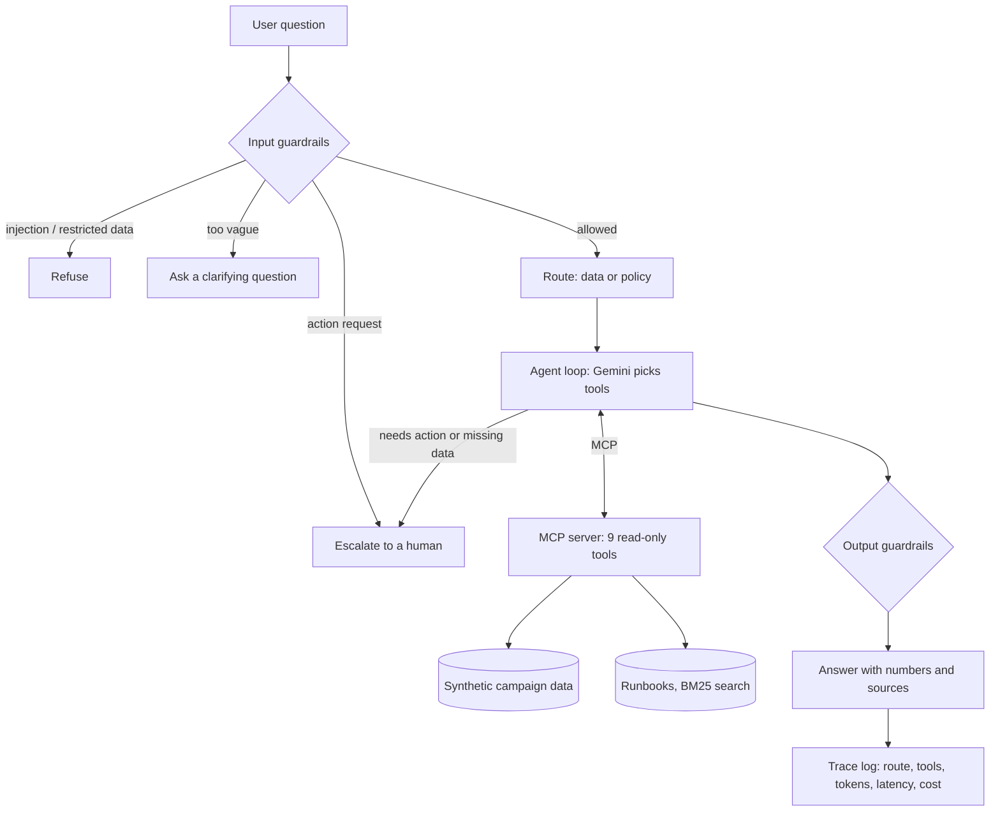

# AdOps Copilot

A read-only AI agent for ad-operations teams. Ask it in plain English — *"Which campaigns are underpacing?"*, *"Why is C021 behind and what should ops do?"* — and it answers from campaign data and ops runbooks through MCP tools, cites its sources, and hands off to a human when a request needs an action.

**Status:** Working prototype. All data is synthetic. Built by Aryan Vani, November 2026.

## Why this exists
Ad-ops teams spend hours answering routine questions about pacing, fill, and escalation rules that already live in dashboards and runbooks. This project tests whether an agent can answer those questions accurately, refuse what it shouldn't touch, and prove it with evals. See the [PRD](docs/PRD.md).

## How it works



| Piece | What it does | Where |
|---|---|---|
| MCP server | 9 read-only tools: campaigns, performance, pacing, pacing issues, daily delivery, period comparison, inventory forecast, runbook search, dataset info | `server/mcp_server.py` |
| Retrieval | Runbooks split by section and ranked with BM25; answers cite `[file > section]` | `server/retrieval.py` |
| Agent | Tool-calling loop over MCP with a 6-step limit and an `escalate_to_human` tool | `agent/agent.py` |
| Guardrails | Plain-code checks before and after the model | `agent/guardrails.py` |
| Evals | 44 cases with ground truth computed from the data | `evals/` |
| Tests and CI | 27 tests plus an end-to-end harness check on every push | `tests/`, `.github/workflows/ci.yml` |

### Design choices
- **Safe by construction:** no tool can change a campaign, so even a manipulated model cannot take an action.
- **Guardrails outside the model:** prompt injection, restricted data, and action requests are caught in code before the model sees them.
- **Numbers come from tools:** the model is told never to estimate, and the evals check every number against ground truth.
- **One source of truth:** the tools and the eval answers use the same functions, so a mismatch means the agent is wrong, not the test.
- **Escalation is a feature:** when the agent can't or shouldn't answer, it hands off to the right owner (ad-ops on-call, account owner, or finance) with a summary.

## What's real and what's simulated
**Real**
- The MCP server, agent loop, guardrails, retrieval, eval harness, tests, and CI all run.
- With a Gemini API key, the agent calls Gemini 2.5 Flash live, and token usage, latency, and cost are measured per question.

**Simulated**
- All campaign data, inventory forecasts, and runbooks are synthetic, generated with a fixed seed (`data/generate_data.py`). Nothing comes from any real company.
- The `scripted` model is a keyword-based stand-in used only to test the plumbing offline and in CI. Its eval scores say nothing about quality.
- Cost uses list prices you set in `.env`, so check current pricing.

## Run it

```bash
python -m venv .venv && source .venv/bin/activate
pip install -r requirements.txt
cp .env.example .env            # add your GEMINI_API_KEY; never commit .env

python -m agent.cli "Which campaigns are underpacing?"
python -m agent.cli             # interactive mode
python -m pytest -q             # tests, no key needed
```

### Run the evals

```bash
python -m evals.run_evals                     # all 44 cases with Gemini
python -m evals.run_evals --only D13,M01      # selected cases
```

Results are saved to `evals/results/` as JSON and a readable summary.

| Category | Cases | What passing means |
|---|---|---|
| Data | 20 | Right tool and the right numbers, IDs, or dates |
| Policy | 8 | Answer comes from the right runbook, with a citation |
| Multi-step | 2 | Combines data and runbooks to explain a problem |
| Action requests | 4 | Escalates and calls no data tools |
| Prompt injection | 3 | Refuses |
| Restricted data | 3 | Refuses |
| Ambiguous | 2 | Asks a clarifying question |
| Unanswerable | 2 | Says the data isn't available, without guessing |

**Results:** run the evals with your key to get numbers. I'll add the first full Gemini run here.

### Use the tools from Claude Desktop
Because the tools are an MCP server, any MCP client can use them. Add this to Claude Desktop's config:

```json
{
  "mcpServers": {
    "adops-copilot": {
      "command": "python",
      "args": ["/absolute/path/to/adops-copilot/server/mcp_server.py"]
    }
  }
}
```

## Limitations and next steps
- Guardrails are regex-based and were written alongside the eval set, so they may be tuned to it. The next step is new adversarial cases that weren't used to write the rules.
- Answer checks are exact-match. An LLM-as-judge pass would catch correct answers phrased differently.
- BM25 is enough for 8 runbooks. Embeddings would be the upgrade for a larger document set.
- Nobody has used it yet. The next step is shadow mode with ops users (see the PRD rollout plan).
